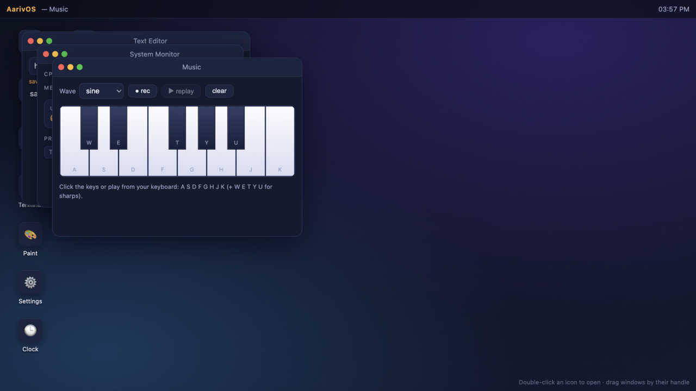

# AarivOS - A 9-App Desktop Operating System in a Browser Tab

**Try AarivOS Live:** [https://aariv.me/webos/](https://aariv.me/webos/)



I built **AarivOS** for the Hack Club Stardance **webOS** mission. Starting from the Hack Club webOS jam guide's window-management fundamentals, I expanded the desktop into a complete, zero-dependency browser operating system with a boot sequence, a focus-aware window manager, a shared `localStorage` virtual file system, and **nine interactive desktop apps** that talk to each other.

---

## Why I Built This

The Hack Club webOS guide walks through building a desktop shell, draggable windows, and a couple of starter windows, then challenges you to make the OS unmistakably your own. I have always loved poking around retro desktop environments and terminal multiplexers, so instead of stopping at static info windows, I wanted to build an OS where the apps actually share state:

- If you write a note in **Notes** or save a document in **Text Editor** (`Cmd/Ctrl + S`), that file immediately exists in the shared virtual file system—so you can open **Files** to inspect it or run `ls` and `cat <filename>` inside **Terminal** to print its contents!
- If you run `open music` or `open paint` in **Terminal**, the shell spawns that desktop window and brings it to the front.
- If you open **System Monitor**, the CPU/memory bars and process list reflect the actual live windows currently open in the `openWindows` map.

---

## All 9 Built-In Applications

| App | Icon | What I Built Into It |
|-----|------|----------------------|
| **1. About (`about`)** | `i` | System overview card detailing AarivOS, keyboard shortcuts, and architecture specs. |
| **2. Files (`files`)** | `[]` | Graphical file manager backed by my `localStorage` virtual file system (`aarivos_fs_v1`). Click any file to inspect its contents in a reader pane, or watch it update live when Notes or Text Editor saves a file. |
| **3. Notes (`notes`)** | `=` | Quick scratchpad that autosaves directly into `/notes.txt` inside the virtual file system as you type. |
| **4. Text Editor (`editor`)** | `ed` | Full multi-file editor with a filename input, **Save** button, and `Cmd/Ctrl + S` keyboard shortcut that writes new or updated files directly into the shared file system. |
| **5. Music Synth (`music`)** | `♪` | Polyphonic-style Web Audio API synthesizer covering a full octave (`C4` to `C5` with sharps/black keys). Includes a `Sine` / `Triangle` waveform switch, playable both by clicking keys and via your computer keyboard (`A S D F G H J K` for white keys, `W E T Y U` for sharps), plus a **Record & Replay** sequencer for looping your melody! |
| **6. Terminal (`terminal`)** | `>_` | Interactive UNIX-style shell supporting `help`, `ls`, `cat <file>`, `echo <text>`, `date`, `whoami`, `open <app>`, and `clear`. Connects directly to both the virtual file system and the window manager. |
| **7. Paint (`paint`)** | `*` | HTML5 `<canvas>` drawing studio with pointer/mouse stroke interpolation, 6 color swatches, adjustable brush size slider, and a one-click canvas clear button. |
| **8. System Monitor (`sysmon`)** | `%` | Live task manager running on `requestAnimationFrame` that displays system uptime since boot, real-time CPU and memory utilization bars scaled by active window load, and process chips for every open app. |
| **9. Settings (`settings`)** | `::` | Control panel to switch between 3 custom desktop wallpapers (saved across reloads) and a factory **Erase All Storage** button to reset the virtual file system. |

---

## How the Window Manager & Virtual File System Work

1. **Unified Window Factory (`createWindow` in `script.js`)**:
   Every app is registered in an `APPS` registry with a `render(bodyEl, winEl)` lifecycle function that can optionally return a cleanup callback (used by **Music** to stop active oscillators and timers, and by **System Monitor** to cancel its `requestAnimationFrame` loop when closed).
2. **Z-Index Stacking & Pointer Dragging**:
   Clicking anywhere inside a window increments `topZ` (`++topZ`), applies `.is-focused` to the active window, and updates the macOS-style top menu bar with the focused application's title. Title bars use pointer capture (`pointerdown` / `pointermove` / `pointerup`) clamped to the desktop bounds so a window can never be dragged off-screen under the top bar.
3. **Shared `localStorage` File System**:
   I wrote `loadFS()` and `saveFS()` helpers around `localStorage` seeded with starter files (`welcome.txt`, `readme.md`, `shortcuts.txt`). Because **Files**, **Notes**, **Text Editor**, and **Terminal** all read and write through the same store and trigger `refreshFilesViews()`, changes in one app show up immediately in the others.

---

## What Was Tricky to Debug

- **Cleaning Up Web Audio & Animation Loops on Window Close**:
   When I first built the **Music** synth and **System Monitor**, closing a window while a recorded melody was replaying left background `setTimeout` notes playing in thin air. I solved this by having each app's `render()` method return a teardown closure (`winEl._cleanup`), which `closeWindow(id)` invokes right before removing the DOM node.
- **Escaping Terminal Output Safely**:
   Early on, printing command output in **Terminal** showed raw HTML tags as literal characters because of how line nodes were appended. I wrote an explicit `escapeHtml()` sanitizer paired with structured line builders so `ls`, `cat`, and `help` render crisp formatted output without allowing HTML injection when running `echo <script>`.

---

## Keyboard Shortcuts

- **Double-Click Desktop Icon** (or focus icon + press **`Enter`**) -> Open app window
- **`Escape`** -> Close the currently focused window
- **`Cmd + S` / `Ctrl + S`** (inside Text Editor) -> Save file to virtual file system
- **`A S D F G H J K`** & **`W E T Y U`** (when Music Synth is focused) -> Play piano notes `C4` through `C5`

---

## How to Run Locally

Open [https://aariv.me/webos/](https://aariv.me/webos/) in your browser, or run it locally with zero install:

```bash
git clone https://github.com/draarivpatel-ui/webos.git
cd webos
python3 -m http.server 8080
# Open http://localhost:8080
```

## License

MIT.
